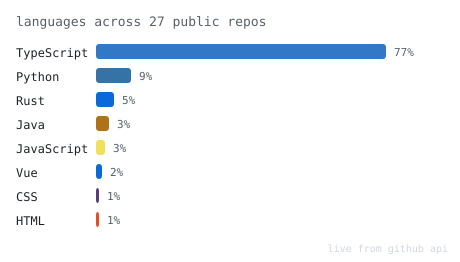

# 👋 Bu Junjie

🎓 Jilin Agricultural University · 📍 Jilin, China

公开仓库主要是 AI Agent、图像工作流，以及一些本地优先的小工具。

<picture>
  <source media="(prefers-color-scheme: dark)" srcset="https://raw.githubusercontent.com/wsbjj/wsbjj/main/dist/langs.svg">
  <source media="(prefers-color-scheme: light)" srcset="https://raw.githubusercontent.com/wsbjj/wsbjj/main/dist/langs-light.svg">
  
</picture>

 

<picture>
  <source media="(prefers-color-scheme: dark)" srcset="https://raw.githubusercontent.com/wsbjj/wsbjj/main/dist/pet.svg">
  <source media="(prefers-color-scheme: light)" srcset="https://raw.githubusercontent.com/wsbjj/wsbjj/main/dist/pet-light.svg">
  
</picture>

## 👀 Visitors statistics

